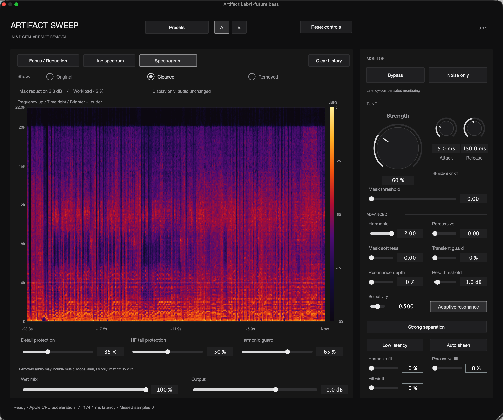
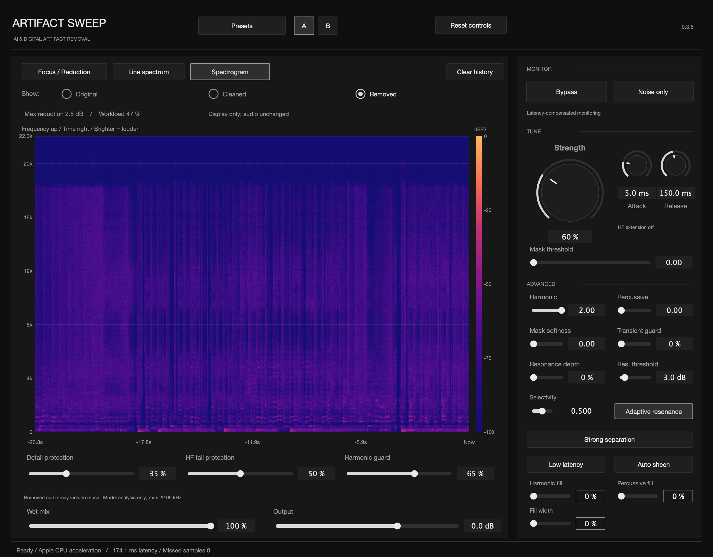

<h1 align="center">Artifact Sweep</h1>

[English](README.md) · [简体中文](README.zh-CN.md) · [日本語](README.ja.md)

> **AI・デジタル音声のアーティファクト除去** · 1.0 公開中。

**[Apple Silicon Mac 版をダウンロード](https://github.com/coopermone/artifact-sweep/releases/tag/v1.0.0-preview.1)** · 英語・簡体字中国語 UI · VST3 / AU

## デジタル処理された音楽のために

Artifact Sweep は、AI 音楽生成、ステム分離、デジタル処理のあとに残るざらつきや耳につく高域などを抑える音声修復プラグインです。処理量と保護設定を調整し、ドラムの立ち上がり、ボーカルの細部、楽器の余韻をできるだけ残せるように設計しています。

特定の一定したノイズだけでなく、音楽に含まれるデジタルアーティファクトを対象にしています。結果は素材によって異なり、強い処理では必要な音まで削れる場合があります。原音比較と除去成分の確認が重要です。

## ローカル AI と調整可能な信号処理

組み込み AI 音声モデルがコンピューター上で短い区間の周波数成分を分析し、帯域ごとの減衰量を推定します。信号処理で変化をなめらかにし、音声を再合成します。処理のために音声をアップロードする必要はありません。

Strength は全体の処理量、周波数フォーカスは処理を重点的にかける帯域、Attack / Release は減衰の反応速度を調整します。保護設定と共振制御で細部や局所的なピークを調整できます。周波数フォーカスは処理の重点を変える機能で、通常の出力 EQ ではありません。

## 主なコントロール

| 機能 | 用途 |
| --- | --- |
| Strength / Attack / Release | 処理量と時間的な反応を調整。 |
| 周波数フォーカス | 選択した帯域の修復を強める、または弱める。 |
| 細部・トランジェント・高域の余韻の保護 | 修復量とアタック、質感、余韻のバランスを調整。 |
| 共振制御 | 抑制の深さ、しきい値、選択性を調整。 |
| Auto sheen / Harmonic・Percussive fill | 明るさや再構成する質感を調整。失われた原音の復元を保証する機能ではありません。 |
| Low latency | 低遅延処理モードを要求。実際の遅延と CPU 負荷はホスト設定と処理モードに依存します。 |
| Bypass / Noise only / A/B / プリセット | 設定を比較し、除去された成分を試聴。 |
| Wet mix / Output | 処理音の混合比と出力レベルを調整。 |

## 三つの解析表示

| 表示 | 確認できる内容 |
| --- | --- |
| Focus / Reduction | 処理を重点的にかける帯域と減衰量。 |
| Line spectrum | 原音・処理後・除去成分を色分けした曲線。 |
| Spectrogram | 時間と周波数に沿った音のエネルギー。原音・処理後・除去成分を切り替え可能。 |

### 処理後の音を確認

スペクトログラムで **Cleaned** を選ぶと処理後の音を表示します。横軸は時間、縦軸は周波数で、明るい色ほどレベルが高いことを示します。表示の切り替えは音声出力を変更しません。

### 除去成分を確認・試聴

**Removed** は除去された成分を表示します。その成分だけを聴くには Monitor の **Noise only** をオンにします。除去成分には音楽も含まれる場合があるため、処理が強すぎないかを判断する参考にしてください。

画像は従来の操作画面を示しています。1.0 も同じコントロール配置を使用します。

## 基本的な使い方

1. 修復したいトラックに挿し、問題が聞き取りやすい箇所をループ再生します。
2. **Strength** を少しずつ上げ、**Bypass** で原音と比較します。
3. **Noise only** を確認し、声や楽器を削りすぎる場合は強さを下げるか保護設定を調整します。
4. 必要な帯域だけ周波数フォーカスや共振制御を調整し、密度の高い部分と静かな余韻の両方を確認します。
5. **A/B** で設定を比較し、Wet mix と Output を調整します。

## ダウンロードとインストール

1.0 は **Apple Silicon Mac** 用の英語・簡体字中国語 **VST3 / AU** を収録しています。Intel Mac / Windows 版は含まれません。

[リリースの Assets](https://github.com/coopermone/artifact-sweep/releases/tag/v1.0.0-preview.1) から **Artifact-Sweep-1.0-candidate.pkg** をダウンロードしてください。DAW を終了してからインストールし、再起動・再スキャン後に **Artifact Sweep** または **Artifact Sweep CN** を選びます。

インストーラーは **Developer ID 署名・公証が未実施**のため、macOS が警告を表示したり実行をブロックしたりする場合があります。システム全体のセキュリティ保護を無効にしないでください。比較が必要な場合は、既存の動作するバージョンを保管してください。

## 検証状況と今後の改善

パッケージ内の英語・中国語プラグインは、ビルド、ネイティブプラグイン、Audio Unit のチェックを通過しています。1.0 の学生モデルは従来の 0.3.5 を基準に改善中で、一部のドラムやミックスでは減衰量と細部の保持に差があります。同等の音質はまだ確認されていません。

CPU 負荷とリアルタイム性能も改善を続けます。このモデルの Ableton 4インスタンス動作は未検証で、旧版の性能結果をそのまま適用できません。今後は音質、推論効率、ホストでの安定性を改善します。

## プロジェクトとソースコード

インストーラーは公開済みです。完全なプラグインのソースコードとビルド手順はまだ公開していません。GitHub の自動生成 ZIP / TAR は、現時点では公開プロジェクト資料のみを含みます。

不具合は [GitHub Issues](https://github.com/coopermone/artifact-sweep/issues) へ、ホスト名、サンプルレート、バッファーサイズ、プラグインのバージョンを添えて報告してください。
