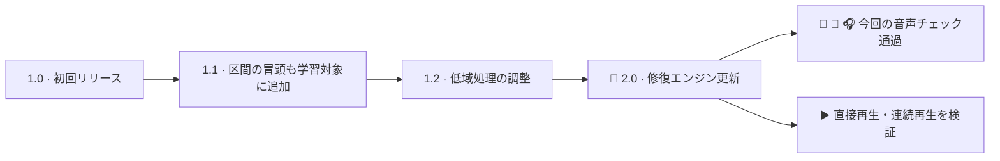

<h1 align="center">Artifact Sweep</h1>

[English](README.md) · [简体中文](README.zh-CN.md) · [日本語](README.ja.md)

## 🎉 2.0 リリースを記念して

**Artifact Sweep の音声修復エンジンが大きく前進しました。** 🧠 2.0 では内蔵音声モデルを更新し、今回の比較テストで 1.2 に残っていたドラム、ギター、複雑なミックスの差を改善しました。🎧 区間の先頭から直接再生する場合と、前の区間から連続再生する場合の両方を検証しています。

🌈 カラースペクトログラムで変化を確認し、**Noise only** で除去成分を試聴。🎛️ 慣れた操作配置と保護設定を引き継ぎ、音声処理はすべてローカルで行います。

## デジタル処理された音楽のために

Artifact Sweep は、AI 音楽生成、ステム分離、デジタル処理のあとに残るざらつきや耳につく高域などを抑える音声修復プラグインです。処理量と保護設定を調整し、ドラムの立ち上がり、ボーカルの細部、楽器の余韻をできるだけ残せるように設計しています。

特定の一定したノイズだけでなく、音楽に含まれるデジタルアーティファクトを対象にしています。結果は素材によって異なり、強い処理では必要な音まで削れる場合があります。原音比較と除去成分の確認が重要です。

## ローカル AI と調整可能な信号処理

組み込み AI 音声モデルがコンピューター上で短い区間の周波数成分を分析し、帯域ごとの減衰量を推定します。信号処理で変化をなめらかにし、音声を再合成します。処理のために音声をアップロードする必要はありません。

Strength は全体の処理量、周波数フォーカスは処理を重点的にかける帯域、Attack / Release は減衰の反応速度を調整します。保護設定と共振制御で細部や局所的なピークを調整できます。周波数フォーカスは処理の重点を変える機能で、通常の出力 EQ ではありません。

## 主なコントロール

| 機能 | 用途 |
| --- | --- |
| Strength / Attack / Release | 処理量と時間的な反応を調整。 |
| 周波数フォーカス | 選択した帯域の修復を強める、または弱める。 |
| 細部・トランジェント・高域の余韻の保護 | 修復量とアタック、質感、余韻のバランスを調整。 |
| 共振制御 | 抑制の深さ、しきい値、選択性を調整。 |
| Auto sheen / Harmonic・Percussive fill | 明るさや再構成する質感を調整。失われた原音の復元を保証する機能ではありません。 |
| Low latency | 低遅延処理モードを要求。実際の遅延と CPU 負荷はホスト設定と処理モードに依存します。 |
| Bypass / Noise only / A/B / プリセット | 設定を比較し、除去された成分を試聴。 |
| Wet mix / Output | 処理音の混合比と出力レベルを調整。 |

## 三つの解析表示

| 表示 | 確認できる内容 |
| --- | --- |
| Focus / Reduction | 処理を重点的にかける帯域と減衰量。 |
| Line spectrum | 原音・処理後・除去成分を色分けした曲線。 |
| Spectrogram | 時間と周波数に沿った音のエネルギー。原音・処理後・除去成分を切り替え可能。 |

### 処理後の音を確認

スペクトログラムで **Cleaned** を選ぶと処理後の音を表示します。横軸は時間、縦軸は周波数で、明るい色ほどレベルが高いことを示します。表示の切り替えは音声出力を変更しません。

### 除去成分を確認・試聴

**Removed** は除去された成分を表示します。その成分だけを聴くには Monitor の **Noise only** をオンにします。除去成分には音楽も含まれる場合があるため、処理が強すぎないかを判断する参考にしてください。

画像は従来の操作画面を示しています。2.0 も同じコントロール配置を使用します。

## 基本的な使い方

1. 修復したいトラックに挿し、問題が聞き取りやすい箇所をループ再生します。
2. **Strength** を少しずつ上げ、**Bypass** で原音と比較します。
3. **Noise only** を確認し、声や楽器を削りすぎる場合は強さを下げるか保護設定を調整します。
4. 必要な帯域だけ周波数フォーカスや共振制御を調整し、密度の高い部分と静かな余韻の両方を確認します。
5. **A/B** で設定を比較し、Wet mix と Output を調整します。

## ダウンロードとインストール

2.0 は **Apple Silicon Mac** 用の英語・簡体字中国語 **VST3 / AU** を収録しています。Intel Mac / Windows 版は含まれません。

[リリースの Assets](https://github.com/coopermone/artifact-sweep/releases/tag/v2.0.0) から **Artifact-Sweep-2.0-macOS-arm64.pkg** をダウンロードしてください。DAW を終了してからインストールし、再起動・再スキャン後に **Artifact Sweep** または **Artifact Sweep CN** を選びます。

インストーラーは **Developer ID 署名・公証が未実施**のため、macOS が警告を表示したり実行をブロックしたりする場合があります。システム全体のセキュリティ保護を無効にしないでください。比較が必要な場合は、既存の動作するバージョンを保管してください。

## 🚀 1.2 から 2.0 への進化

| 項目 | 1.2 | 2.0 |
| --- | --- | --- |
| 🥁 ドラム・🎸 ギター | 一部の区間で固定の音声比較基準に未達。 | 今回のドラム・ギター比較項目をすべて通過。 |
| 🎧 複雑なミックス | 低域の除去波形に差が残っていました。 | 重点的に検証した第2ミックス区間と楽曲全体のチェックを通過。 |
| ▶️ 再生状態 | 直接再生と連続再生で異なる差が発生。 | 先行音声が 0・125・500・1,000・2,000 ms の条件を検証。 |
| 🌈 操作 | 三つの解析表示と修復コントロール。 | 同じ操作配置を維持し、モデルを更新。 |

同じ重点ミックス区間で、固定検証ターゲットに対する除去波形のコサイン類似度は **1.2 の 0.9272 から 2.0 の 0.9999 超へ**改善しました。これは検証素材での一致度を表し、ノイズ除去率やすべての音楽に共通する音質評価ではありません。素材とホストの検証範囲を引き続き拡充します。

## プロジェクトとソースコード

インストーラーは公開済みです。完全なプラグインのソースコードとビルド手順はまだ公開していません。GitHub の自動生成 ZIP / TAR は、現時点では公開プロジェクト資料のみを含みます。

不具合は [GitHub Issues](https://github.com/coopermone/artifact-sweep/issues) へ、ホスト名、サンプルレート、バッファーサイズ、プラグインのバージョンを添えて報告してください。

**[Apple Silicon Mac 版をダウンロード](https://github.com/coopermone/artifact-sweep/releases/tag/v2.0.0)** · 英語・簡体字中国語 UI · VST3 / AU
