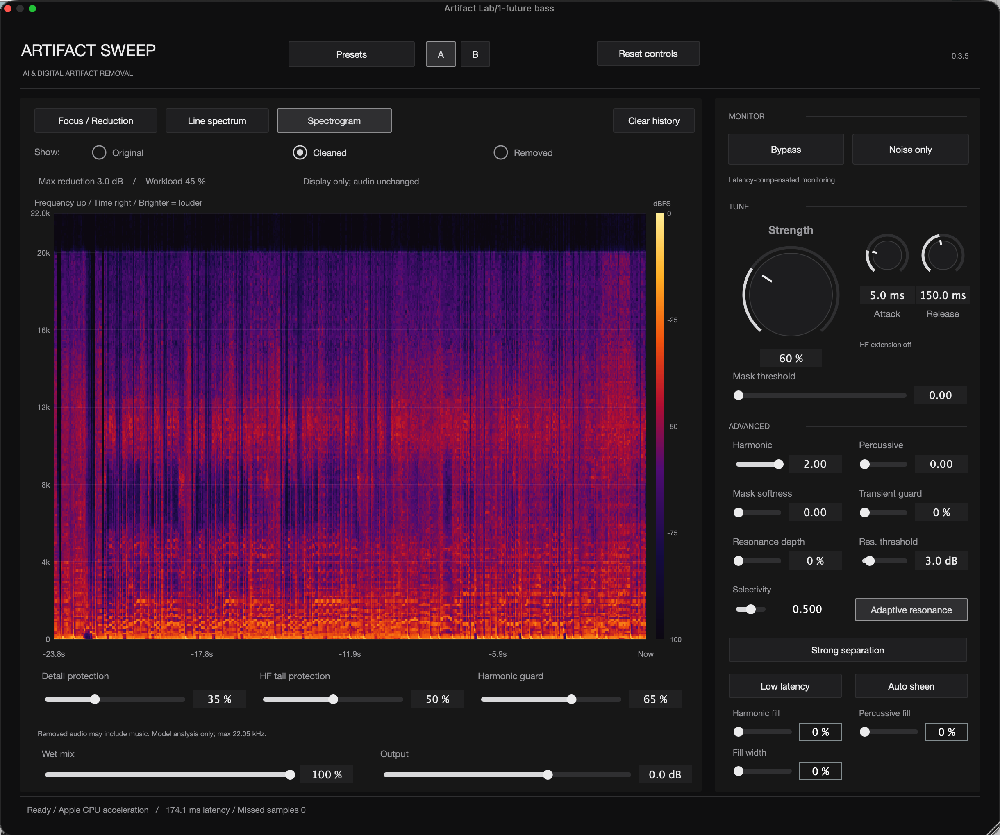
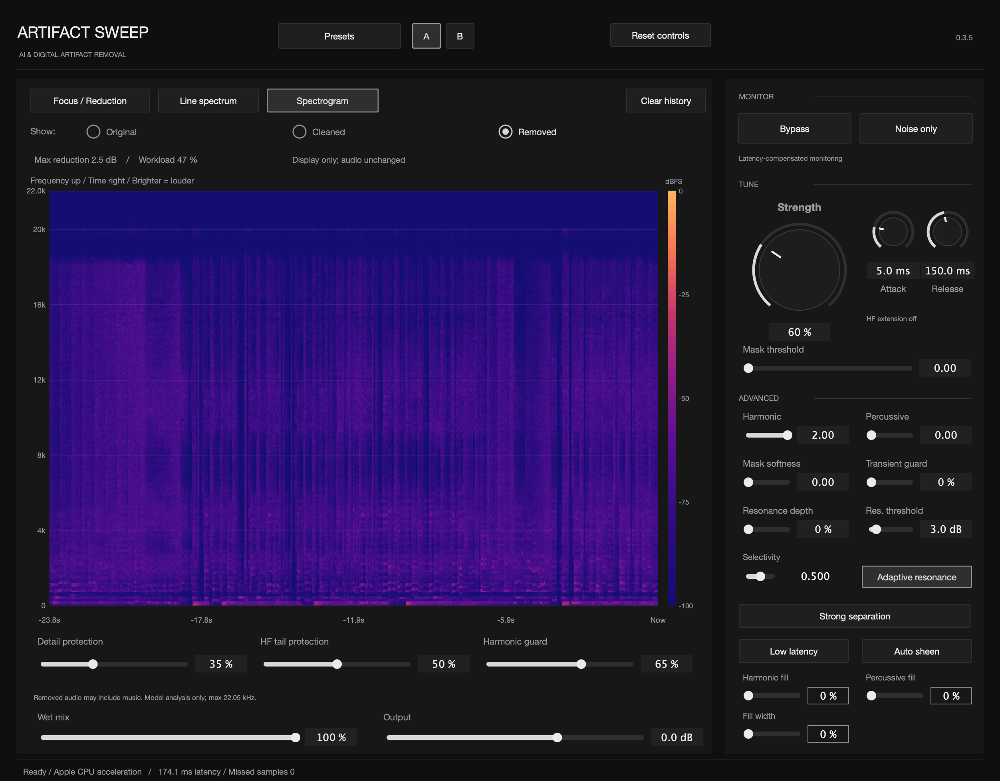

<h1 align="center">Artifact Sweep</h1>

[English](README.md) · [简体中文](README.zh-CN.md) · [日本語](README.ja.md)

> **AI & digital artifact removal** · Version 1.1 is available.

**[Download for Apple Silicon Mac](https://github.com/coopermone/artifact-sweep/releases/tag/v1.1.0)** · English & Simplified Chinese · VST3 / AU

## Designed for digitally processed music

Artifact Sweep is an audio repair plug-in for the gritty textures, fizz, and brittle highs that can remain after AI music generation, stem separation, or digital processing. Adjustable repair strength and protection controls help you balance artifact reduction with drum attacks, vocal detail, and instrument decay.

It is designed for musical artifacts rather than a single fixed noise profile. Results depend on the source: stronger attenuation can also remove desirable musical content, so comparison and residual monitoring are part of the workflow.

## Local AI with controllable signal processing

An embedded AI audio model runs on your computer. It analyzes short slices of audio in the frequency domain and estimates attenuation across frequency bands. Signal processing smooths those estimates over time and reconstructs the audio. Processing does not require uploading audio.

Strength sets the overall amount of repair; frequency focus adjusts where processing is emphasized. Attack and release shape how quickly attenuation engages and recovers. Protection and resonance controls provide additional ways to preserve detail and manage narrow spectral peaks. The frequency-focus curve changes the processing emphasis; it is not a conventional output EQ.

## Main controls

| Control group | Purpose |
| --- | --- |
| Strength, attack and release | Adjust processing amount and response over time. |
| Frequency focus | Emphasize or relax repair in selected frequency regions. |
| Detail, transient and high-frequency tail protection | Balance cleanup with attacks, texture and decays. |
| Resonance controls | Adjust the depth, threshold and selectivity of resonance suppression. |
| Auto sheen and harmonic / percussive fill | Shape brightness and reconstructed texture; these do not guarantee recovery of missing original detail. |
| Low latency | Request the lower-latency processing mode; actual latency and CPU load depend on host settings and processing mode. |
| Bypass, Noise only, A/B and presets | Compare settings and hear what processing removes. |
| Wet mix and output | Blend the processed signal and adjust output level. |

## Three complementary analysis views

| View | What it shows |
| --- | --- |
| Focus / Reduction | Frequency emphasis and the amount of attenuation. |
| Line spectrum | Color-separated curves for the original, cleaned and removed signals. |
| Spectrogram | Sound energy across time and frequency, with original, cleaned and removed views. |

### Inspect the cleaned signal

Select **Cleaned** in the spectrogram to see the processed signal. Time runs left to right, frequency rises vertically, and brighter colors indicate higher levels. Switching the display does not change the audio output.

### Inspect and listen to what was removed

Select **Removed** to inspect the removed component. To hear it on its own, enable **Noise only** in the Monitor panel. Removed audio can contain musical content as well as unwanted artifacts: use it to judge whether processing is too strong.

The screenshots show the established interface; the downloaded 1.1 build uses the same control layout.

## A practical starting workflow

1. Insert Artifact Sweep on the track you want to repair and loop an affected passage.
2. Increase **Strength** gradually, using **Bypass** to compare with the source.
3. Enable **Noise only**. If too much voice, percussion or instrument detail is removed, lower Strength or increase the appropriate protection.
4. Adjust frequency focus and resonance controls only where needed. Check both a dense passage and a quieter decay.
5. Compare settings with **A/B**, then set wet mix and output for the track.

## Download and install

Version 1.1 includes English and Simplified Chinese **VST3 / Audio Unit** plug-ins for **Apple Silicon Mac**. Intel Mac and Windows builds are not included.

Download **Artifact-Sweep-1.1.pkg** from the [release Assets](https://github.com/coopermone/artifact-sweep/releases/tag/v1.1.0). Quit your DAW, run the installer, then reopen the host and rescan plug-ins. Select **Artifact Sweep** or **Artifact Sweep CN**.

The installer is **not Developer ID signed or notarized**; macOS may display a warning or block it. Do not disable system-wide security protections. Keep an existing working version if you need to compare releases.

## Current validation and ongoing work

The English and Chinese plug-ins passed native VST3 and Audio Unit checks. In 1.1, output moved closer to the 0.3.5 reference on seven of eight natural excerpts, with the clearest gains on drums and a full-mix excerpt. Some synthetic tests and the full-song preservation score declined slightly.

CPU load and real-time performance need further optimization. Four-instance Ableton performance has not been established for this packaged model; older performance results should not be treated as measurements of 1.1. Future updates will focus on sound quality, efficient inference and host stability.

## Project and source status

The installer is publicly available. The complete plug-in source and build instructions are not yet public. GitHub's automatic source ZIP / TAR archives currently contain the public project materials, not the complete software source.

For feedback, use [GitHub Issues](https://github.com/coopermone/artifact-sweep/issues) and include your host, sample rate, buffer size and plug-in version.
