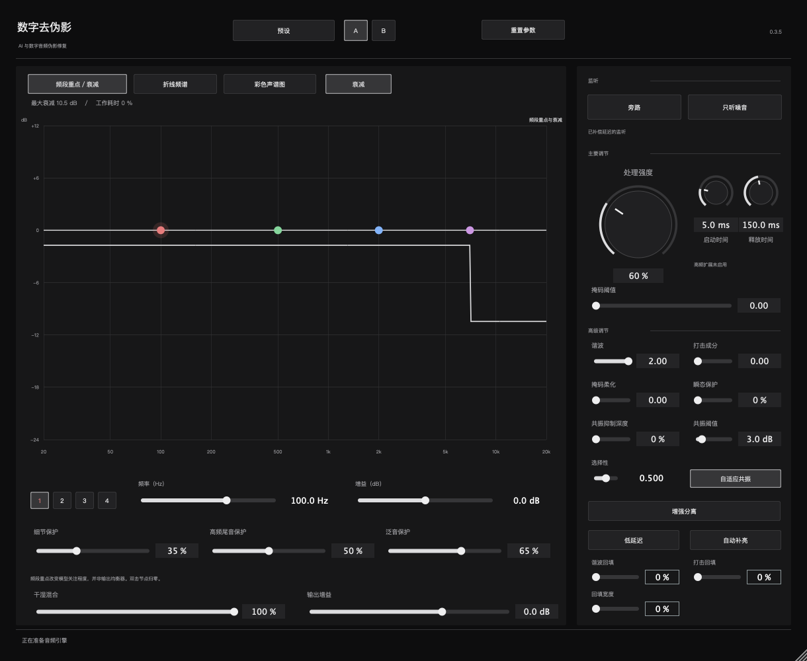

<h1 align="center">Artifact Sweep · 数字去伪影</h1>

[English](README.md) · [简体中文](README.zh-CN.md) · [日本語](README.ja.md)

> **早期预告** · 面向 AI 音乐和数字处理音频的修复插件。

*开发版操作界面，图表使用测试数据。*

## 它能做什么

用于减轻 AI 生成、音源分离或数字处理后留下的毛刺、沙粒感和发刺的高频。处理强度可调，方便在削减伪影的同时尽量保留鼓点、人声细节和乐器尾音。

## 它怎么处理

插件把声音拆成短时频谱，估计各频段需要衰减多少，让衰减随时间平滑变化，再把频谱合成回音频。可以调节处理强度、频段重点、启动和释放，控制哪里需要处理，以及处理介入的速度。

开发版提供三种图表。衰减图看处理量，折线频谱对照原声、处理后和被移除的成分，彩色声谱图看这些变化出现在什么时间和频率。

## 在宿主里怎么用

1. 把插件加到需要修复的音轨，循环播放伪影最明显的一段。
2. 慢慢增加**处理强度**，用**旁路**来回对比。
3. 开启**只听噪音**，单独听被移除的成分。如果人声、鼓点或乐器细节也被明显削弱，就降低强度或调高对应的保护。

## 平台与发布状态

当前开发目标是 **Apple Silicon Mac**，插件格式为 **VST3** 和 **AU**。首个公开版本计划使用独立开发的模型。模型和宿主验证完成后，会在这里发布源码、构建说明和版本记录。
