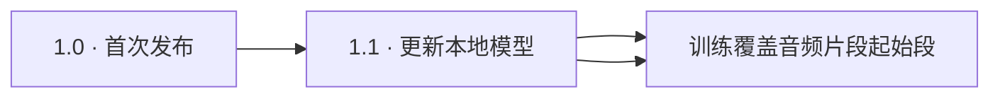

<h1 align="center">Artifact Sweep · 数字去伪影</h1>

[English](README.md) · [简体中文](README.zh-CN.md) · [日本語](README.ja.md)

> **AI 与数字音频去伪影** · 1.2 已发布。

## 为数字处理后的音乐而设计

Artifact Sweep 是一款音频修复插件，针对 AI 音乐生成、分轨和数字处理后可能留下的毛刺、沙粒感、杂散纹理与刺耳高频。通过可调处理强度和细节保护，在减少伪影的同时尽量保留鼓点、人声细节及乐器尾音。

它面向音乐中的数字伪影，而非仅针对一种固定底噪。实际效果取决于素材；处理过强也可能削弱正常音乐，因此原声对照和移除成分监听是使用流程的一部分。

## 本地 AI 与可调信号处理

插件内置在电脑本地运行的 AI 音频模型。模型分析声音的短时频谱，估计各频段的衰减量，再由信号处理平滑衰减变化并重建声音。处理过程无需上传音频。

处理强度控制总体修复量；频段重点决定哪些频率需要加强或放松处理；启动与释放控制衰减介入和恢复的速度。细节保护与共振控制进一步帮助保留音乐结构、调整局部频谱峰值。频段重点曲线调整的是处理侧重，并非传统的输出均衡器。

## 主要控制

| 控制区域 | 用途 |
| --- | --- |
| 处理强度、启动与释放 | 调整处理量及随时间变化的响应。 |
| 频段重点 | 对选定频率区域加强或放松修复。 |
| 细节、瞬态与高频尾音保护 | 平衡清理效果与起音、纹理、衰减尾音。 |
| 共振控制 | 调整共振抑制的深度、阈值和选择性。 |
| 自动补亮、谐波与打击成分回填 | 调整亮度及重建纹理，不代表能够还原已经丢失的原始细节。 |
| 低延迟 | 请求较低延迟的处理模式；实际延迟和 CPU 占用取决于宿主设置与处理模式。 |
| 旁路、只听噪音、A/B 与预设 | 比较设置，并单独监听被移除的声音。 |
| 干湿混合与输出 | 混合处理信号并调整输出电平。 |

## 三种互相补充的分析图表

| 图表 | 显示内容 |
| --- | --- |
| 频段重点 / 衰减 | 处理侧重及各频段衰减量。 |
| 折线频谱 | 用不同颜色对照原声、处理后和被移除的成分。 |
| 彩色声谱图 | 显示声音能量随时间与频率的分布，可切换原声、去噪后及移除成分。 |

### 查看去噪后的声音

在声谱图中选择 **Cleaned（去噪后声音）**。横轴是时间，纵轴是频率，颜色越亮表示声音能量越强。切换图表选项只改变显示，不会改变音频输出。

### 查看并试听被移除的成分

选择 **Removed（被移除的声音）**，检查被削减的成分出现在什么时间和频段。要单独听这些声音，再打开右侧的 **Noise only（只听噪音）**。移除成分可能包含正常音乐，不能把它全部视为噪声；这也是判断处理是否过强的直接参考。

截图展示既有操作界面；下载的 1.2 沿用相同的控制布局。

## 建议使用流程

1. 将插件插入需要修复的音轨，循环播放问题较明显的一段。
2. 逐步提高**处理强度**，用**旁路**与原声比较。
3. 打开**只听噪音**。若人声、鼓点或乐器细节也被大量移除，降低强度或提高对应保护。
4. 按需调整频段重点与共振控制，同时检查密集段落和较安静的尾音。
5. 用 **A/B** 比较设置，最后调整干湿混合和输出电平。

## 下载与安装

1.2 包含适用于 **Apple Silicon Mac** 的中英文 **VST3 / AU** 插件，不包含 Intel Mac 或 Windows 版本。

在[发行页的 Assets 附件区](https://github.com/coopermone/artifact-sweep/releases/tag/v1.2.0)下载 **Artifact-Sweep-1.2-macOS-arm64.pkg**。退出宿主后安装，重新打开宿主并扫描插件，选择 **Artifact Sweep** 或 **Artifact Sweep CN**。

安装包**尚未进行 Apple Developer ID 签名及公证**，macOS 可能弹出提示或阻止安装。不要关闭系统级安全保护；需要版本对照时，请保留已有可用版本。

## 1.2 更新了什么

1.2 细化了本地修复模型的低频处理，沿用 1.1 的操作布局和插件格式。复杂混音的低频处理仍在优化。

## 项目与源码状态

软件安装包已公开。完整插件源码和构建说明尚未公开；GitHub 自动生成的源码 ZIP / TAR 压缩包目前仅包含公开项目资料，并非完整的软件源码。

欢迎通过 [GitHub Issues](https://github.com/coopermone/artifact-sweep/issues) 反馈，附上宿主、采样率、缓冲区大小和插件版本，方便复现问题。

**[下载 Apple Silicon Mac 版本](https://github.com/coopermone/artifact-sweep/releases/tag/v1.2.0)** · 中英文界面 · VST3 / AU
